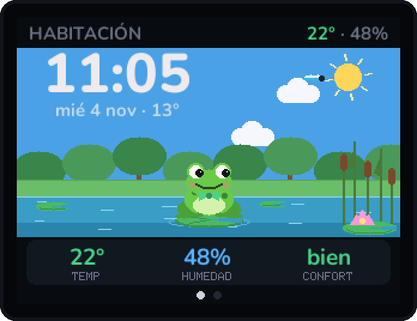

# Panel de escritorio ESP32

<p align="center"></p>

Un panel de 2.4" para la mesa con una mascota animada. Muestra la hora, el tiempo y la temperatura de la habitación, tus tareas de Telegram y lo que suena en Spotify. Funciona con un ESP32, una pantalla ST7789, un sensor DHT11 y un botón táctil TTP223.

> **Esta rama:** diseño **F · Rana en el estanque**. Cada diseño de la pantalla Habitación vive en su propia rama `design/<nombre>`; consulta la [galería](#diseños-de-la-habitación).

## Qué hace

| Pantalla | Qué muestra |
|---|---|
| **Habitación** | Reloj grande, fecha y tiempo de Madrid; la mascota con su escena; temperatura, humedad y confort del DHT11 |
| **Tareas** | Las tareas que mandas al bot de Telegram, con prioridad, progreso y aviso cuando llega una nueva |
| **Música** | La canción de Spotify (o Last.fm en la versión gratuita): portada grande, fondo difuminado, ecualizador y barra de progreso |

- Un **toque** en el botón cambia de pantalla.
- Si **mantienes pulsado** más de 1 s en Habitación, acaricias a la mascota.

### Cómo reacciona la mascota

- **Por la noche** (23:00–8:00) se duerme. Un toque la despierta un momento.
- **Según la temperatura** de la habitación: tiembla con frío y suda con calor. Además, un detalle de su ropa (collar, bufanda, pajarita…) toma el color del confort.
- **Cuando llega una tarea**, la trae en un sobre.

## Diseños de la Habitación

Hay seis mascotas con su propio escenario. Todas comparten el mismo comportamiento (estados de ánimo y acciones). Solo cambia el dibujo: `room_scene.*` y `cat_draw.cpp`.

| | | |
|:-:|:-:|:-:|
| <br>**E · Robot en la estación**<br>[`design/robot`](../../tree/design/robot) | <br>**A · Gatito en su cuarto**<br>[`design/gato`](../../tree/design/gato) | <br>**B · Perrito en el jardín**<br>[`design/perro`](../../tree/design/perro) |
| <br>**C · Pingüino en el polo**<br>[`design/pinguino`](../../tree/design/pinguino) | <br>**D · Pececito en la pecera**<br>[`design/pez`](../../tree/design/pez) | <br>**F · Rana en el estanque** ⭐<br>[`design/rana`](../../tree/design/rana) |

⭐ = el diseño de esta rama. Los GIF son capturas reales del firmware: el código de dibujo se compila en el PC (ver [herramientas](#herramientas)).

### E · Robot en la estación

Un robot que flota en una estación espacial, con un ojo de buey al espacio. El planeta cambia de color con la temperatura de la habitación y el panel parpadea.

**Qué hace:** Vuela de lado a lado, escanea con la pantalla, se queda sin batería, estira los brazos y bota. Por la noche se sienta en su base a cargar, con gorro de dormir.

| Día | Noche | Frío |
|:-:|:-:|:-:|
|  |  |  |
| **Calor** | **Caricia** | **Nueva tarea** |
|  |  |  |

<details><summary>De noche (animado)</summary>


</details>

Pruébalo: `git checkout design/robot`

### A · Gatito en su cuarto

El diseño original: una ventana con el cielo según la hora y el tiempo real, una alfombra y una planta.

**Qué hace:** Pasea, mira alrededor, se lava, bosteza, se estira y salta. Por la noche se duerme en su cojín.

| Día | Noche | Frío |
|:-:|:-:|:-:|
|  |  |  |
| **Calor** | **Caricia** | **Nueva tarea** |
|  |  |  |

<details><summary>De noche (animado)</summary>


</details>

Pruébalo: `git checkout design/gato`

### B · Perrito en el jardín

Exterior a pantalla completa. El cielo, las nubes, la lluvia (con charcos) y la nieve (en el césped y el tejado) siguen al tiempo real. Valla, colinas y caseta.

**Qué hace:** Trota, levanta una oreja, se rasca, bosteza, hace la reverencia de juego y salta. Por la noche se enrosca en su cojín. Si hace frío, bufanda y vaho; si hace calor, lengua fuera.

| Día | Noche | Frío |
|:-:|:-:|:-:|
|  |  |  |
| **Calor** | **Caricia** | **Nueva tarea** |
|  |  |  |

<details><summary>De noche (animado)</summary>


</details>

Pruébalo: `git checkout design/perro`

### C · Pingüino en el polo

Montañas de hielo, mar, nieve e iglú. Las noches despejadas tienen aurora boreal animada y, si la habitación está caliente, aparecen charcos de deshielo.

**Qué hace:** Camina como un pato, se acicala, abre el pico, se pone de puntillas y salta. Duerme sentado con gorro. Con frío le salen chispitas de felicidad; con calor suda y se abanica.

| Día | Noche | Frío |
|:-:|:-:|:-:|
|  |  |  |
| **Calor** | **Caricia** | **Nueva tarea** |
|  |  |  |

<details><summary>De noche (animado)</summary>


</details>

Pruébalo: `git checkout design/pinguino`

### D · Pececito en la pecera

Toda la pantalla es agua. Su color sigue a la temperatura de la habitación (más azul con frío, más verde con calor, más oscura de noche). Hay arena, algas, un castillo y burbujas.

**Qué hace:** Nada de lado a lado, mira, echa burbujas, bosteza, abre las aletas y da un acelerón. Por la noche descansa en la arena.

| Día | Noche | Frío |
|:-:|:-:|:-:|
|  |  |  |
| **Calor** | **Caricia** | **Nueva tarea** |
|  |  |  |

<details><summary>De noche (animado)</summary>


</details>

Pruébalo: `git checkout design/pez`

### F · Rana en el estanque

Estanque con nenúfares, juncos, flor de loto y árboles. Cuando llueve salen anillos en el agua. De día vuela una libélula y de noche hay luciérnagas.

**Qué hace:** Rema en su nenúfar, caza moscas con la lengua, croa inflando la papada, estira las patas y pega saltos enormes. Por la noche duerme tapada con una hoja.

| Día | Noche | Frío |
|:-:|:-:|:-:|
|  |  |  |
| **Calor** | **Caricia** | **Nueva tarea** |
|  |  |  |

<details><summary>De noche (animado)</summary>


</details>

Pruébalo: `git checkout design/rana`

## Cambiar de diseño

```bash
git checkout design/perro          # o gato, pinguino, pez, robot, rana
cd firmware
pio run -e esp32dev -t upload      # mantén BOOT pulsado mientras pone "Connecting..."
```

`firmware/src/secrets.h` no está en git, así que se conserva al cambiar de rama.

## Hardware

| Pieza | Notas |
|---|---|
| ESP32 DevKit (38 pines, micro-USB) | |
| Pantalla ST7789 de 2.4", 240×320 | se usa en horizontal (320×240) |
| DHT11 | temperatura y humedad, en GPIO27 |
| TTP223 | botón táctil, en GPIO32. Funciona a través de 1.2 mm de plástico |

- **Cableado:** [`firmware/WIRING.md`](firmware/WIRING.md).
- **Caja imprimible (Mini TV retro):** [`enclosure/retro_tv`](enclosure/retro_tv). Es un script de Fusion 360 que deja las piezas listas para imprimir.
- **Otras cajas:** [`enclosure/viewer`](enclosure/viewer) tiene un visor 3D con seis ideas.

## Cómo funciona

```
Telegram ──webhook──▶ FastAPI (OCI) ──HTTPS──▶ ESP32 ──SPI──▶ ST7789
Spotify / Last.fm ──▶   /nowplaying               ▲
Open-Meteo ─────────▶   /weather              DHT11 + TTP223
```

- **[`backend/`](backend)**: FastAPI con SQLite.
  - Bot de Telegram para las tareas.
  - `/nowplaying`: Spotify, o Last.fm si la cuenta es gratuita. La portada llega ya compuesta a 320×200 con su color de acento.
  - `/weather`: el tiempo de Open-Meteo, con caché de 10 min.
- **[`firmware/`](firmware)**: PlatformIO + TFT_eSPI.
  - La red va en un hilo propio, en el núcleo 0.
  - Las fuentes Nunito son suaves (anti-aliasing).
  - Las animaciones usan sprites, así que no parpadean.
  - La lógica (estados de ánimo, comportamiento, interfaz) tiene tests en el PC: `pio test -e native`.

## Herramientas

| Herramienta | Para qué |
|---|---|
| [`firmware/tools/snapshots`](firmware/tools/snapshots) | `python firmware/tools/snapshots/snap.py` compila el código de dibujo real en el PC, con una imitación de TFT_eSPI, y genera las capturas y los GIF de `docs/` |
| [`firmware/tools/simulator`](firmware/tools/simulator) | Simulador en el navegador (robot): hora, temperatura, tiempo, caricias… |
| [`firmware/tools/make_fonts.py`](firmware/tools/make_fonts.py) | Genera las fuentes suaves |
